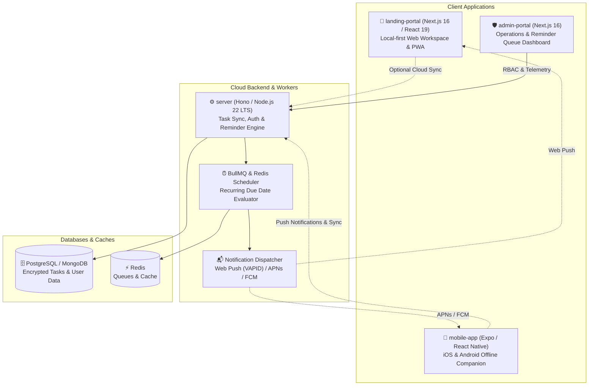

# 🔁 Again Monorepo

Welcome to the **Again Monorepo**—a unified codebase containing the entire ecosystem for **Again**, a minimal, private, and local-first recurring task tracker and maintenance upkeep platform.

Unlike streak-driven habit trackers, **Again** is built for real-world upkeep: changing HVAC filters, descaling coffee machines, vehicle oil changes, watering plants, and backing up devices. It calculates the next due date forward from when a task is actually completed, keeping your routines realistic, stress-free, and private.

<p align="left">
  
  
  
  
  
  
  
  
</p>

---

## 📋 Table of Contents

- [Ecosystem Architecture](#ecosystem-architecture)
- [📦 Package Manager Policy](#-package-manager-policy)
- [🗂️ Monorepo Workspaces Overview](#️-monorepo-workspaces-overview)
- [🛠️ Workspaces Deep-Dive](#️-workspaces-deep-dive)
  - [1. 🧩 landing-portal (Web App & Workspace)](#1--landing-portal-web-app--workspace)
  - [2. 🛡️ admin-portal (Management & Telemetry)](#2-️-admin-portal-management--telemetry)
  - [3. ⚙️ server (API & Sync Engine)](#3-️-server-api--sync-engine)
  - [4. 📱 mobile-app (Cross-Platform Companion)](#4--mobile-app-cross-platform-companion)
- [⚡ Quickstart & Local Setup](#-quickstart--local-setup)
- [📜 Monorepo Scripts](#-monorepo-scripts)
- [🔒 Privacy & Local-First Philosophy](#-privacy--local-first-philosophy)
- [🤝 Contributing](#-contributing)
- [📄 License & Authors](#-license--authors)

---

## 🏗️ Ecosystem Architecture



---

## 📦 Package Manager Policy

> [!IMPORTANT]
> To ensure reproducible builds and dependency isolation:
> - 🌐 **Core Workspaces (`landing-portal`, `admin-portal`, `server`)**: Strictly use **[pnpm](https://pnpm.io)** (`pnpm@11.x`).
> - 📱 **Mobile App (`mobile-app`)**: Uses **[Bun](https://bun.sh)** (`bun`) for ultra-fast native bundle compilation.

| Workspace | Directory | Framework / Stack | Package Manager | Status |
| :--- | :--- | :--- | :---: | :---: |
| **Landing Portal** | [`landing-portal/`](file:///home/abdullah/MyProject/again-monorepo/landing-portal) | Next.js 16, React 19, Tailwind CSS v4, shadcn/ui, Vitest | **`pnpm`** | Active |
| **Admin Portal** | [`admin-portal/`](file:///home/abdullah/MyProject/again-monorepo/admin-portal) | Next.js 16, React 19, Tailwind CSS v4, Radix Primitives | **`pnpm`** | Ready |
| **Backend Server** | [`server/`](file:///home/abdullah/MyProject/again-monorepo/server) | Hono / Express, Node.js 22 LTS, Redis, BullMQ, Better-Auth | **`pnpm`** | Ready |
| **Mobile App** | [`mobile-app/`](file:///home/abdullah/MyProject/again-monorepo/mobile-app) | Expo (React Native), TypeScript, Zustand, SQLite | **`bun`** | Planned |

---

## 🗂️ Monorepo Workspaces Overview

```text
again-monorepo/
├── admin-portal/        # Next.js 16 administrative operations and telemetry dashboard
│   ├── src/             # Dashboard, queue inspector, user directory, and metrics
│   └── README.md        # Dedicated Admin Portal documentation
├── landing-portal/      # Next.js 16 local-first recurring task tracker and PWA
│   ├── src/             # App router, domain features, shadcn/ui primitives, theme tokens
│   ├── tests/           # Vitest recurring calculation engine unit tests
│   └── README.md        # Dedicated Landing Portal documentation
├── server/              # High-performance API, cloud sync engine, and BullMQ worker
│   ├── src/             # Hono endpoints, sync protocol, auth handlers, and workers
│   └── README.md        # Dedicated Backend Server documentation
├── mobile-app/          # Cross-platform Expo / React Native mobile client
├── pnpm-workspace.yaml  # pnpm multi-package workspace configuration
├── package.json         # Unified monorepo scripts and workspace references
├── .gitignore           # Global monorepo ignore rules
└── README.md            # Root ecosystem documentation (this file)
```

---

## 🛠️ Workspaces Deep-Dive

### 1. 🧩 [landing-portal](file:///home/abdullah/MyProject/again-monorepo/landing-portal) (Web App & Workspace)
* **Package Manager**: **`pnpm`**
* **Port**: `http://localhost:3000`
* **Core Highlights**:
  * **Local-First Architecture**: Stores all tasks, history, and theme settings locally in `localStorage` (`again.tasks.v1`) with zero external dependency.
  * **Recurring Date Engine**: Pure, deterministic date arithmetic handling days, weeks, months, years, month-end clamping (Jan 31 → Feb 28), and leap-year rules.
  * **5 Bespoke Themes**: Light, Dark, Green Forest, Blue Ocean, and Dune powered by semantic CSS tokens.
  * **Productivity Shortcuts**: Quick add (<kbd>N</kbd>), global search (<kbd>Ctrl</kbd>/<kbd>⌘</kbd> + <kbd>K</kbd>), and ESC dismissal.
  * **Offline PWA Shell**: Service worker caching and web manifest for installable app behavior.
  * **Test Coverage**: 14+ unit tests validating edge cases with Vitest.
* 👉 Read the [landing-portal README](file:///home/abdullah/MyProject/again-monorepo/landing-portal/README.md) for full documentation.

---

### 2. 🛡️ [admin-portal](file:///home/abdullah/MyProject/again-monorepo/admin-portal) (Management & Telemetry)
* **Package Manager**: **`pnpm`**
* **Port**: `http://localhost:3001`
* **Core Highlights**:
  * **Central Metrics**: Aggregate analytics for active workspaces, completion volume, and recurrence frequency curves.
  * **Reminder Queue Inspector**: Live health monitoring of scheduled background notification jobs via Redis / BullMQ.
  * **User & Device Directory**: Management of user quotas, device tokens (Web Push, APNs, FCM), and security sessions.
  * **Remote Feature Toggles**: Dynamic runtime flags for gradual feature rollouts and sync rate limiting.
* 👉 Read the [admin-portal README](file:///home/abdullah/MyProject/again-monorepo/admin-portal/README.md) for full documentation.

---

### 3. ⚙️ [server](file:///home/abdullah/MyProject/again-monorepo/server) (API & Sync Engine)
* **Package Manager**: **`pnpm`**
* **Port**: `http://localhost:8080`
* **Core Highlights**:
  * **Cloud Sync Protocol**: Incremental delta synchronization with monotonic versioning and last-write-wins (LWW) conflict resolution.
  * **Automated Notification Worker**: BullMQ scheduler checking due tasks and dispatching Web Push (RFC 8291 / 8292), APNs, and FCM notifications.
  * **Identity & RBAC**: Better-Auth integration with secure HttpOnly cookies, session management, and granular permission roles.
  * **Production Ready**: Structured Pino logging, health probes (`/health`, `/metrics`), and Docker container support.
* 👉 Read the [server README](file:///home/abdullah/MyProject/again-monorepo/server/README.md) for full documentation.

---

### 4. 📱 [mobile-app](file:///home/abdullah/MyProject/again-monorepo/mobile-app) (Cross-Platform Companion)
* **Package Manager**: **`bun`**
* **Core Highlights**:
  * Native offline-first mobile app for iOS and Android built with Expo and React Native.
  * Local SQLite storage for zero-latency mobile interactions.
  * Home screen widgets for immediate overview of today's overdue and due tasks.
  * Background push notifications via APNs and FCM.

---

## ⚡ Quickstart & Local Setup

### Prerequisites
- **Node.js**: `v20.9.0` or newer (Node 22 LTS recommended)
- **pnpm**: `v11.x` (`npm install -g pnpm@11`)
- **Redis**: Optional, required if running `server/` reminder queues (`docker run -p 6379:6379 redis:alpine`)

---

### 1. Clone the Monorepo

```bash
git clone git@github.com:AbdullahAlMaksud/again-monorepo.git
cd again-monorepo
```

### 2. Install Dependencies

Install dependencies for all pnpm workspaces simultaneously:

```bash
pnpm install
```

---

### 3. Running Individual Workspaces

You can run individual workspaces from root or by navigating to their folder:

#### Run the Web App (`landing-portal`):
```bash
# From monorepo root:
pnpm dev:landing

# Or navigate directly:
cd landing-portal && pnpm dev
```
Open [http://localhost:3000](http://localhost:3000) in your browser.

#### Run the Admin Dashboard (`admin-portal`):
```bash
# From monorepo root:
pnpm dev:admin

# Or navigate directly:
cd admin-portal && pnpm dev
```
Open [http://localhost:3001](http://localhost:3001) in your browser.

#### Run the Backend Server (`server`):
```bash
# From monorepo root:
pnpm dev:server

# Or navigate directly:
cd server && pnpm dev
```
API endpoints will be active on [http://localhost:8080](http://localhost:8080).

---

## 📜 Monorepo Scripts

Available commands from the monorepo root:

| Command | Action |
| :--- | :--- |
| `pnpm dev:landing` | Starts the `landing-portal` Next.js development server on port 3000 |
| `pnpm dev:admin` | Starts the `admin-portal` development server on port 3001 |
| `pnpm dev:server` | Starts the `server` API with hot-reload on port 8080 |
| `pnpm build:landing` | Compiles production bundle for `landing-portal` |
| `pnpm build:admin` | Compiles production bundle for `admin-portal` |
| `pnpm build:server` | Compiles production server build |
| `pnpm test` | Runs all test suites across all workspaces (Vitest, unit tests) |
| `pnpm lint` | Runs ESLint across all workspaces |
| `pnpm typecheck` | Validates TypeScript across all workspaces |

---

## 🔒 Privacy & Local-First Philosophy

Again is designed from day one to respect user privacy:
1. **Local-First by Default**: The web workspace stores all data directly in the browser's local storage. No sign-up, email, or account creation is required to use all task management features.
2. **Zero Creepy Analytics**: No behavioral trackers, third-party advertising pixels, or telemetry beacons exist in the user-facing web app.
3. **Data Portability**: Users own their data. Full JSON export and import guarantees that tasks and history can be backed up or transferred at any time.

---

## 🤝 Contributing

Contributions to the Again ecosystem are welcome!

1. Fork this repository or create a feature branch:
   ```bash
   git checkout -b feature/amazing-feature
   ```
2. Make your improvements following the architectural guidelines of the respective workspace.
3. Run the validation checks:
   ```bash
   pnpm typecheck
   pnpm lint
   pnpm test
   ```
4. Commit your changes with meaningful commit messages:
   ```bash
   git commit -m "feat(landing): add custom recurrence interval units"
   ```
5. Open a Pull Request detailing your problem statement, solution, and screenshots if applicable.

---

## 📄 License & Authors

This project is licensed under the **MIT License**.

Maintained by **[Abdullah Al Maksud](https://github.com/AbdullahAlMaksud)** (<maksud.workspace@gmail.com>).
